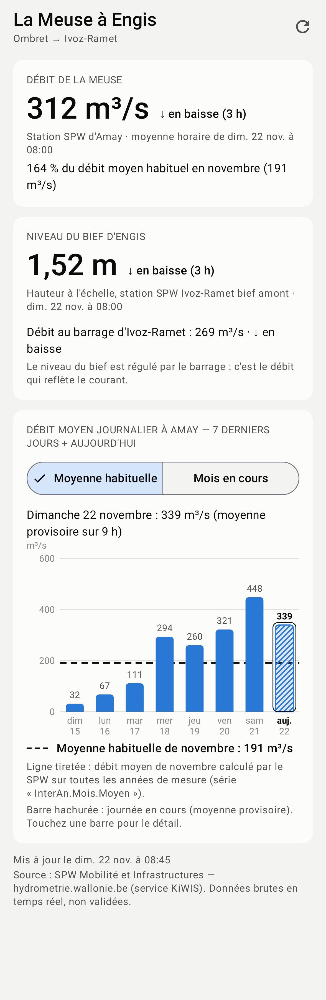

# Meuse Engis — débit et niveau de la Meuse (Ombret → Ivoz-Ramet)



Application Android personnelle qui affiche, à partir des mesures en temps réel du SPW :

- le **débit actuel de la Meuse** à la station d'Amay, sa tendance sur 3 h et sa comparaison avec le débit moyen habituel du mois ;
- le **niveau du bief d'Engis**, mesuré à la station Ivoz-Ramet bief amont, ainsi que le débit au barrage d'Ivoz-Ramet ;
- un **graphique en barres** du débit moyen journalier sur les 7 derniers jours et le jour en cours. Une ligne horizontale tiretée y indique la moyenne du mois, au choix :
  - *Moyenne habituelle* : moyenne interannuelle du mois calculée par le SPW ;
  - *Mois en cours* : moyenne des débits horaires depuis le 1er du mois.

## Installation sur le téléphone

1. Copier `release/MeuseEngis-1.0.apk` sur le téléphone, par exemple en le téléchargeant depuis GitHub ou en l'envoyant par e-mail.
2. Ouvrir le fichier. Android demande d'autoriser l'installation depuis cette source (« sources inconnues ») : accepter.
3. Lancer **Meuse Engis**.

Configuration requise : Android 8.0 ou plus récent. L'application demande uniquement l'accès à Internet. La version 1.0 est signée avec une clé de développement : elle convient à un usage personnel, pas à une publication sur le Play Store.

## Utilisation

- Les données sont rechargées à l'ouverture de l'application si elles datent de plus de 10 minutes. On peut aussi actualiser manuellement en tirant l'écran vers le bas ou avec le bouton ⟳.
- Toucher une barre affiche le détail de la journée correspondante.
- La dernière réponse reçue est conservée et reste affichée sans réseau, avec un avertissement.

## Sources des données

Service web KiWIS du SPW Mobilité et Infrastructures (<https://hydrometrie.wallonie.be>). L'accès est anonyme. Toutes les séries sont demandées en une seule requête par actualisation.

| Station SPW | N° | Série (ts_name) | ts_id | Usage |
|---|---|---|---|---|
| AMAY (Meuse moyenne) | 7132 | `10-Debit ultrason.1h.Moyen` | 245548010 | Débit actuel, moyennes journalières, moyenne du mois en cours |
| AMAY | 7132 | `80-Debit ultrason.InterAn.Mois.Moyen` | 245483010 | Moyenne habituelle du mois |
| IVOZ-RAMET Bief Amont | 7117 | `10-Hauteur.1h.Moyen` | 245351010 | Niveau du bief |
| IVOZ-RAMET Bief Amont | 7117 | `10-Debit.1h.Moyen` (débit axe hydraulique) | 408403010 | Débit au barrage |

Le débit moyen journalier est calculé comme la moyenne des valeurs horaires de 00 h à 23 h, heure belge. Pour les 20 et 21/11/2026, ce calcul reproduit exactement la série SPW `20-Debit ultrason.Jour.Moyen` (321,493 et 448,014 m³/s). Il permet aussi d'afficher une moyenne provisoire pour la journée en cours, que le SPW ne publie qu'à J+1.

**Avertissement** : ce sont des données brutes en temps réel, non validées, qui peuvent être corrigées par la suite.

## Développement

```bash
./gradlew testDebugUnitTest   # tests de calcul + rendu de l'écran (app/build/screenshots/)
./gradlew assembleRelease     # APK : app/build/outputs/apk/release/app-release.apk
```

Le projet est un module unique en Kotlin et Jetpack Compose, structuré en `data` (client KiWIS, cache), `domain` (calculs) et `ui` (écran, graphique). Il n'utilise ni Hilt ni Room : l'architecture multi-module du skill serait disproportionnée pour un écran unique.
