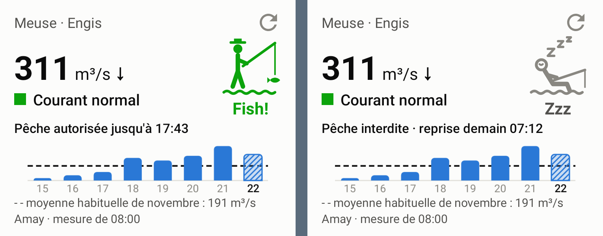

# Meuse Engis — débit et niveau de la Meuse (Ombret → Ivoz-Ramet)

| Application | Widget |
|---|---|
|  |  |

Application Android personnelle qui affiche, à partir des mesures en temps réel du SPW :

- le **débit actuel de la Meuse** à la station d'Amay, avec sa tendance sur 3 h et une **appréciation du courant** (voir plus bas) ;
- le **niveau du bief d'Engis**, mesuré à la station Ivoz-Ramet bief amont, ainsi que le débit au barrage d'Ivoz-Ramet ;
- un **graphique en barres** du débit moyen journalier sur les 7 derniers jours et le jour en cours. Une ligne horizontale tiretée y indique la moyenne du mois, au choix :
  - *Moyenne habituelle* : moyenne interannuelle du mois calculée par le SPW ;
  - *Mois en cours* : moyenne des débits horaires depuis le 1er du mois.

## Appréciation du courant (faible / normal / fort / très fort)

Pour chaque jour du calendrier, le SPW publie les débits statistiques observés à Amay sur toutes les années de mesure (depuis 1995). Ce sont les séries « InterAn.Jour » P15, P85 et P90. Le débit actuel est classé ainsi :

| Classe | Règle | Exemple pour un 22 novembre |
|---|---|---|
| Courant faible | débit < P15 | < 66 m³/s |
| Courant normal | P15 ≤ débit ≤ P85 | 66 à 330 m³/s |
| Courant fort | P85 < débit ≤ P90 | 330 à 380 m³/s |
| Courant très fort | débit > P90 | > 380 m³/s |

Ces seuils sont les miens, posés sur les statistiques du SPW. Ils disent si le débit est **inhabituel pour la saison**, pas s'il permet de pêcher : un « courant normal » de novembre peut déjà être fort au bord de l'eau. L'écran affiche les valeurs de seuil du jour pour que chacun se fasse son propre repère.

## Réglementation de la pêche au carnassier

L'application applique les règles de l'**AGW du 8 décembre 2016 relatif aux conditions d'ouverture et aux modalités d'exercice de la pêche**, dans sa version consolidée en vigueur depuis le 01/01/2025 (Wallex, consultée le 22/11/2026). Elle les applique à la Meuse, qui relève de la zone d'eaux calmes (annexe 3).

| Règle | Article |
|---|---|
| Carnassiers (brochet, sandre, perche, aspe : groupe 2) ouverts **du 1er samedi de juin au 31 janvier** | Art. 4, 2°, c) et d) |
| Fermés du 1er février jusqu'à la veille du 1er samedi de juin | Art. 4, 2°, a) et b) |
| Pêche de jour : **de 1 h avant l'heure officielle du lever du soleil à 1 h après l'heure officielle du coucher** | Art. 1er, 6° |
| Pêche de nuit interdite pour ces espèces | Art. 5 |

La rubrique « Voir les règles principales » rappelle aussi les autres points utiles :
- pas de pêche du haut des ponts, ni à moins de 50 m en aval des barrages ;
- brochet : aucun prélèvement autorisé jusqu'au 31/12/2027 ;
- sandre et perche : tailles minimales et nombre maximal par jour ;
- leurres interdits pendant la fermeture du brochet.

Ce qui relève de mon interprétation, et non du texte :
- **L'heure officielle** du lever et du coucher n'est pas définie géographiquement par l'arrêté. L'application calcule le lever et le coucher pour Uccle (référence de l'IRM) et pour Engis, et retient la plage la plus courte des deux.
- J'ajoute une **marge de sécurité d'1 minute** de chaque côté : mon calcul diffère d'environ ±20 s des éphémérides de référence.
- Les heures affichées sont donc toujours un peu plus prudentes que la règle stricte.
- Les interdictions temporaires locales (art. 7) ne peuvent pas être connues de l'application : il faut respecter la signalisation sur place.

## Widget d'écran d'accueil

Appui long sur l'écran d'accueil, puis **Widgets**, puis **Meuse Engis**, puis **Meuse · courant**.

- **Pêcheur vert « Fish! »** : la pêche au carnassier est autorisée maintenant et le courant est normal.
- **Pêcheur endormi « Zzz »** : la pêche est interdite maintenant, la nuit ou pendant la fermeture. Le widget affiche l'heure ou la date de reprise.
- Aucun pêcheur : la pêche est autorisée, mais le courant est faible, fort ou très fort.
- Taille 2×1 : débit actuel, tendance, appréciation du courant et pêcheur.
- Taille 3×2 ou plus : en plus, les barres des 7 derniers jours et d'aujourd'hui, avec la moyenne habituelle du mois.
- Le widget se met à jour toutes les 30 minutes environ (rythme minimal autorisé par Android), à chaque actualisation dans l'application, et quand on touche ⟳. Il se met aussi à jour aux heures d'ouverture et de fermeture de la pêche, avec une alarme Android qui peut avoir jusqu'à 5 minutes de décalage. Toucher le reste du widget ouvre l'application.

## Installation sur le téléphone

1. Ouvrir sur le téléphone le lien direct <https://github.com/laurentnoulez-lab/claude-android-skill/raw/ccr-d5695511-sqnn3o/apps/meuse-engis/release/MeuseEngis-1.4.apk> ou scanner le QR code `release/telecharger-qr.png`. On peut aussi copier `release/MeuseEngis-1.4.apk` sur le téléphone, par exemple en le téléchargeant depuis GitHub ou en l'envoyant par e-mail.
2. Ouvrir le fichier. Android demande d'autoriser l'installation depuis cette source (« sources inconnues ») : accepter.
3. Lancer **Meuse Engis**.

Configuration requise : Android 8.0 ou plus récent. L'application demande uniquement l'accès à Internet. Les versions sont signées avec une clé de développement : cela convient à un usage personnel, pas à une publication sur le Play Store. Si Android refuse une mise à jour (« conflit de signature »), désinstaller l'ancienne version puis installer la nouvelle.

## Utilisation

- Les données sont rechargées automatiquement : à l'ouverture, puis toutes les 10 minutes tant que l'application reste affichée. Le SPW publie une nouvelle valeur horaire environ chaque heure. On peut aussi actualiser à la main en tirant l'écran vers le bas ou avec le bouton ⟳.
- Le bandeau du haut indique quand les données ont été reçues ; il passe en rouge au-delà de 20 minutes. Chaque mesure affiche son heure et son âge, par exemple « 09:00 (il y a 52 min) ».
- Toucher une barre affiche le détail de la journée correspondante.
- La dernière réponse reçue est conservée et reste affichée sans réseau, avec un avertissement.

## Fonctionnement autonome

L'application interroge **elle-même**, depuis le téléphone, le serveur public du SPW. Il n'y a ni serveur intermédiaire, ni compte, ni clé d'accès.

- **Quand :** à l'ouverture de l'application (si les données ont plus de 10 min), en tirant l'écran vers le bas, et via le widget (environ toutes les 30 min, ou en touchant ⟳).
- **Sans réseau :** la dernière réponse reçue reste affichée avec un avertissement. Un message apparaît aussi si une station ne transmet plus depuis plus de 3 h.
- **Si le SPW renumérote ses séries :** il refuse alors toute la requête, avec une erreur HTTP 500. L'application retrouve d'elle-même les nouveaux identifiants à partir du numéro de station et du nom de la série, puis les mémorise. En dernier recours, elle demande chaque série séparément et affiche celles qui répondent.
- **Certificat HTTPS :** celui du SPW (Let's Encrypt, rattaché à ISRG Root X1) est reconnu par Android 8 et plus.

Ce fonctionnement a été vérifié le 22/11/2026 contre le vrai serveur, avec le test `LiveSpwTest` (`MEUSE_LIVE_TEST=1 ./gradlew testDebugUnitTest --tests '*LiveSpwTest*'`) :
- la mesure de 09:00 a été obtenue 20 min plus tard ;
- les 7 jours passés étaient complets (24 h chacun) ;
- une renumérotation simulée a été réparée.

## Sources des données

Service web KiWIS du SPW Mobilité et Infrastructures (<https://hydrometrie.wallonie.be>). L'accès est anonyme. Toutes les séries sont demandées en une seule requête par actualisation.

| Station SPW | N° | Série (ts_name) | ts_id | Usage |
|---|---|---|---|---|
| AMAY (Meuse moyenne) | 7132 | `10-Debit ultrason.1h.Moyen` | 245548010 | Débit actuel, moyennes journalières, moyenne du mois en cours |
| AMAY | 7132 | `80-Debit ultrason.InterAn.Mois.Moyen` | 245483010 | Moyenne habituelle du mois |
| AMAY | 7132 | `76-…InterAn.Jour.P15`, `73-…Median`, `77-…P85`, `78-…P90` | 245502010, 245520010, 245488010, 245531010 | Appréciation du courant |
| IVOZ-RAMET Bief Amont | 7117 | `10-Hauteur.1h.Moyen` | 245351010 | Niveau du bief |
| IVOZ-RAMET Bief Amont | 7117 | `10-Debit.1h.Moyen` (débit axe hydraulique) | 408403010 | Débit au barrage |

Le débit moyen journalier est calculé comme la moyenne des valeurs horaires de 00 h à 23 h, heure belge. Pour les 20 et 21/11/2026, ce calcul reproduit exactement la série SPW `20-Debit ultrason.Jour.Moyen` (321,493 et 448,014 m³/s). Il permet aussi d'afficher une moyenne provisoire pour la journée en cours, que le SPW ne publie qu'à J+1.

**Avertissement** : ce sont des données brutes en temps réel, non validées, qui peuvent être corrigées par la suite.

## Développement

```bash
./gradlew testDebugUnitTest   # tests de calcul + rendus de l'écran et du widget (app/build/screenshots/)
./gradlew assembleRelease     # APK : app/build/outputs/apk/release/app-release.apk
```

Le projet est un module unique en Kotlin et Jetpack Compose, structuré en `data` (client KiWIS, cache), `domain` (calculs), `ui` (écran, graphique) et `widget` (Jetpack Glance). Il n'utilise ni Hilt ni Room : l'architecture multi-module du skill serait disproportionnée pour un écran unique.
