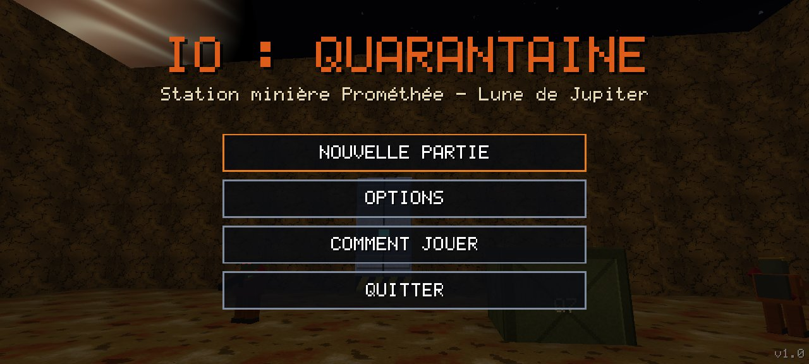
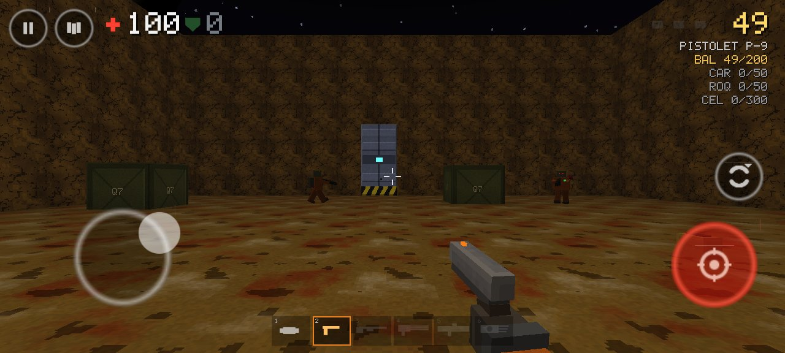
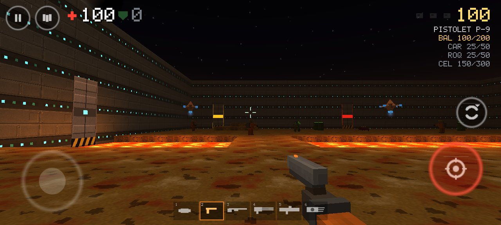
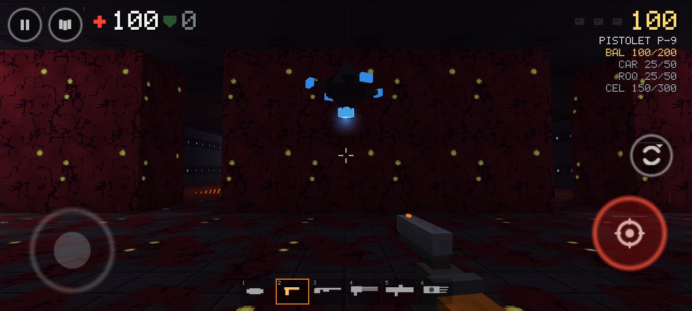
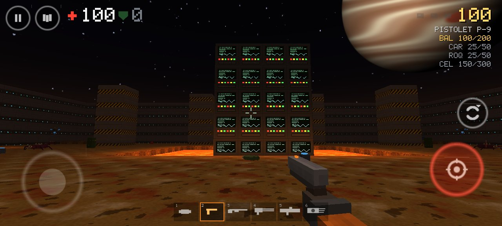

# IO : QUARANTAINE

FPS 3D low-poly pour smartphone Android, dans l'esprit des jeux de tir des années 90 (rythme rapide, clés de couleur, secrets, boss final). Univers, cartes, modèles, textures, sons et musiques sont **originaux et générés par le code** : l'APK ne contient aucun fichier graphique ou sonore.

> Station minière Prométhée, sur Io, lune de Jupiter. Le signal de détresse s'est tu il y a six heures. Vous êtes le seul marine envoyé sur place.



| Secteur 1 – Hangar | Secteur 2 – Raffinerie |
|---|---|
|  |  |
| **Secteur 3 – Laboratoires xéno** | **Secteur 4 – Cœur du réacteur (boss)** |
|  |  |

## Installer sur le téléphone

1. Téléchargez [`release/IO-Quarantaine-v1.0.apk`](release/IO-Quarantaine-v1.0.apk) (≈ 124 Ko) sur le téléphone.
2. Ouvrez le fichier. Android demande d'autoriser l'installation depuis cette source (navigateur ou gestionnaire de fichiers) : acceptez pour cette application uniquement.
3. Lancez **IO : Quarantaine** (mode paysage).

Configuration requise : Android 8.0 (API 26) ou plus récent, OpenGL ES 2.0. Aucune permission sensible : seule la vibration est demandée.

Play Protect peut afficher un avertissement car l'application ne provient pas du Play Store : c'est normal pour une installation manuelle.

## Commandes

| Action | Geste |
|---|---|
| Se déplacer | Joystick virtuel : pouce gauche n'importe où sur la moitié gauche |
| Tourner / viser | Glisser le pouce droit sur la moitié droite |
| Tirer | Bouton rouge (on peut le faire glisser pour viser en tirant) |
| Changer d'arme | Icônes en bas de l'écran, ou petit bouton rond à droite |
| Portes | S'ouvrent à l'approche (certaines exigent une carte d'accès) |
| Passages secrets | Pousser les murs suspects |
| Carte / Pause | Boutons en haut à gauche |
| Retour Android | Pause / retour au menu |

## Contenu

- **3 secteurs + l'antre du boss** : Hangar de quarantaine, Raffinerie de soufre (coulées de soufre en fusion, ciel ouvert avec Jupiter), Laboratoires xéno, Cœur du réacteur.
- **6 armes** : Gantelet à impulsion, Pistolet P-9, Fusil à pompe, Mitrailleuse rotative, Lance-roquettes, Annihilateur.
- **5 ennemis + boss** : Mineur infecté (tir), Rampant (rapide), Cracheur (acide), Brute (charge), Drone sentinelle (volant), L'Hôte (roquettes, acide, invocations).
- Barils explosifs (réactions en chaîne), cartes rouge/bleue/jaune, 5 passages secrets, carte automatique.
- **3 difficultés** : Recrue, Soldat, Cauchemar.
- **Options** : sensibilité de visée, axe vertical inversé, visée assistée verticale, vibrations, volumes musique/effets.
- **Sauvegarde** automatique au début de chaque secteur (armes, munitions, santé), records de temps par secteur et difficulté.
- **Audio** : 37 effets synthétisés, 6 musiques générées en temps réel (menu, 3 secteurs, boss, victoire), son stéréo positionnel.

## Compiler

Prérequis : JDK 17+ et le SDK Android (plateforme 35). Indiquer le SDK via `ANDROID_HOME` ou `local.properties` (`sdk.dir=...`).

```bash
./gradlew :core:test            # tests (logique, niveaux, audio, police)
./gradlew :app:assembleRelease  # APK : app/build/outputs/apk/release/app-release.apk
```

Captures d'écran hors écran (Linux avec Mesa) :

```bash
EGL_PLATFORM=surfaceless ./gradlew :desktop:run --args="$PWD/desktop/out"
```

## Architecture

```
core/     Jeu complet en Kotlin pur, indépendant d'Android (testable sur JVM)
  world/    Cartes ASCII, cellules, portes, lumières
  game/     Simulation : physique, armes, IA (champ de navigation), boss, sauvegarde
  gfx/      Rendu OpenGL ES 2.0 : maillage du décor + éclairage pré-calculé, modèles low-poly, ciel, textures procédurales
  audio/    Synthèse des effets, séquenceur musical, mélangeur
  ui/       HUD, menus, police bitmap 5x8 avec accents
app/      Adaptateur Android : GLSurfaceView, AudioTrack, vibrations, SharedPreferences
desktop/  Banc de test : rendu headless (LWJGL + Mesa) pour captures automatiques
```

Aucune dépendance externe dans l'application (uniquement le SDK Android et la bibliothèque standard Kotlin).

## Vérifications effectuées

- 19 tests automatisés : chargement des 4 cartes, collisions, marches, portes, armes et munitions, IA, sauvegarde, couverture de la police, sons et musiques non silencieux, **pilote automatique qui traverse chaque secteur avec la vraie physique** jusqu'à la sortie (et jusqu'au boss).
- Shaders validés avec `glslangValidator` (GLSL ES 1.00, profil des téléphones).
- Captures réelles produites par le moteur via OpenGL ES (Mesa llvmpipe).
- APK signé (schéma v2) et vérifié avec `apksigner`.

**Non vérifié** : le jeu n'a pas pu être exécuté sur un téléphone ou un émulateur Android dans l'environnement de développement (pas d'accélération matérielle disponible). La fluidité réelle, le ressenti des commandes et la latence audio restent à confirmer sur votre appareil.

## Remarques

- `app/debug.keystore` est une clé de signature de développement (mot de passe `android`) versionnée volontairement : elle permet d'installer les versions suivantes par-dessus la précédente sans perdre la sauvegarde. Elle n'a aucune valeur de sécurité et ne doit pas servir à une publication sur le Play Store.
- Le rendu est plafonné à 720 lignes puis agrandi à l'écran, pour rester fluide sur les téléphones modestes.
